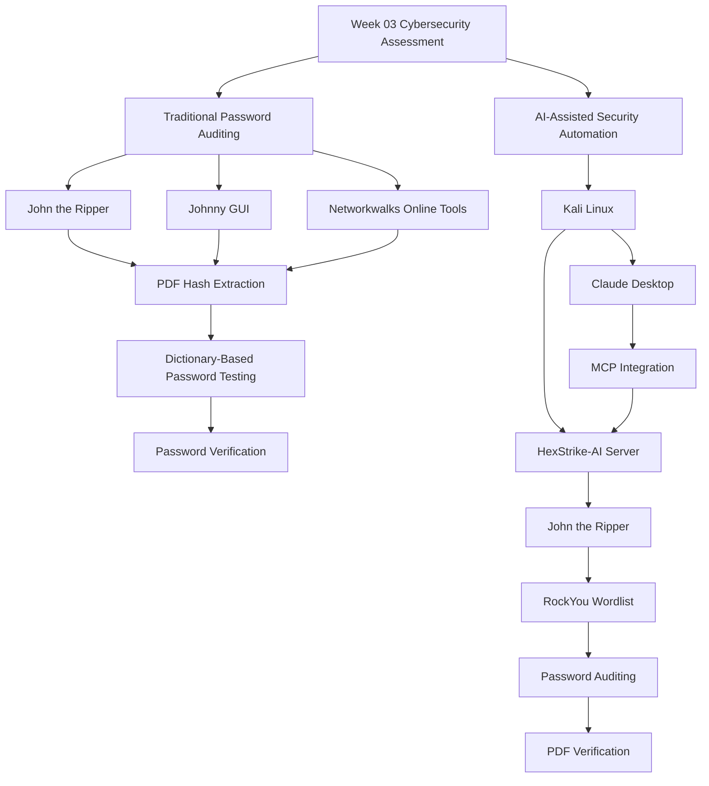
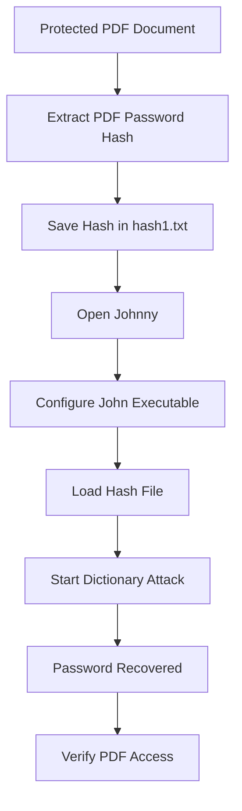
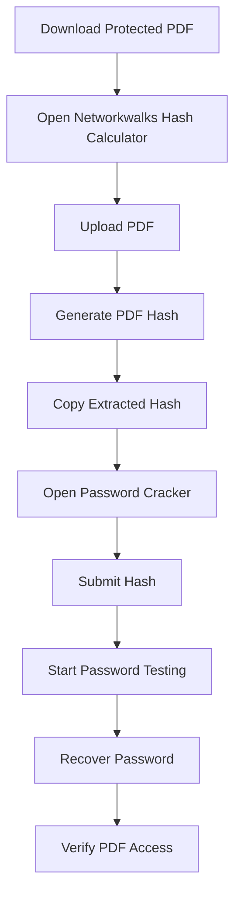
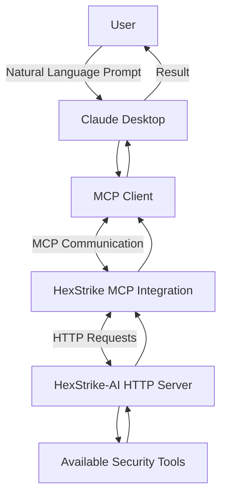
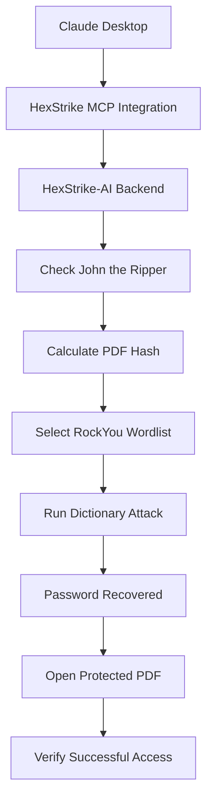

<div align="center">

# 🔐 CYBERSECURITY & ETHICAL HACKING

## WEEK 03 – TECHNICAL LABORATORY REPORT

### Password Security Assessment, Dictionary-Based Auditing & AI-Assisted Security Testing


**Prepared by: Nida Ibrahim Khedekar**

**Networkwalks Academy | Cybersecurity & Ethical Hacking Internship**

</div>

---

# 📋 TABLE OF CONTENTS

1. Engagement Overview
2. Liability & Authorization Disclaimer
3. Introduction
4. Objectives
5. Tools & Technologies
6. Laboratory Architecture
7. Module 01 – Password Cracking Using John the Ripper and Johnny
8. Module 02 – Password Cracking Using Networkwalks Tools
9. Module 03 – HexStrike-AI MCP Server Integration with Claude Desktop
10. Module 04 – AI-Assisted Password Auditing Using HexStrike-AI and John the Ripper
11. Technical Comparison of Implemented Approaches
12. Password Security Concepts
13. Technical Analysis of MCP Architecture
14. Security Risks & Impact Assessment
15. Observations & Technical Considerations
16. Security Recommendations
17. Skills Demonstrated
18. Assessment Results
19. Key Learning Outcomes
20. Conclusion
21. Project Information

---

# 1. 📌 ENGAGEMENT OVERVIEW

| Parameter                      | Details                         |
| ------------------------------ | ------------------------------- |
| Organization                   | Networkwalks Academy            |
| Internship Domain              | Cybersecurity & Ethical Hacking |
| Internship Batch               | B084                            |
| Assessment Week                | Week 03                         |
| Primary Focus                  | Password Security Assessment    |
| Secondary Focus                | AI-Assisted Security Automation |
| Operating Systems              | Windows and Kali Linux          |
| Primary Password Auditing Tool | John the Ripper                 |
| Graphical Interface            | Johnny                          |
| AI Assistant                   | Claude Desktop                  |
| MCP Integration                | HexStrike-AI                    |
| Dictionary Source              | RockYou Wordlist                |
| Assessment Type                | Controlled Laboratory Exercises |
| Prepared By                    | Nida Ibrahim Khedekar           |

### Engagement Summary

Week 03 focused on understanding password security, performing controlled password-auditing exercises, and exploring the integration of artificial intelligence with cybersecurity tools.

The assessment began with conventional password recovery techniques using John the Ripper and its graphical interface, Johnny. It was then extended to browser-based password-cracking utilities provided by Networkwalks.

The final part involved configuring the HexStrike-AI MCP environment on Kali Linux and integrating it with Claude Desktop. This enabled an AI-assisted workflow in which natural-language instructions could be used to interact with available cybersecurity tools.

The exercises provided practical exposure to both traditional password-auditing methodologies and emerging AI-assisted security workflows.

---

# 2. ⚖️ LIABILITY & AUTHORIZATION DISCLAIMER

All activities documented in this report were performed as part of authorized cybersecurity training and educational laboratory exercises.

The password-auditing activities were conducted on intentionally provided, password-protected PDF files. The tools and techniques were used exclusively to understand password security, hash extraction, dictionary-based password testing, and security automation.

The HexStrike-AI environment was configured locally for educational experimentation.

No unauthorized systems, accounts, networks, or third-party resources were targeted.

**Ethical and Legal Considerations:**

* Password auditing should only be performed on files and systems for which explicit authorization has been obtained.
* Dictionary attacks must not be used to access unauthorized accounts or protected information.
* AI-assisted security tools should be operated within a controlled and authorized environment.
* Recovered credentials and sensitive information must be handled responsibly.
* All testing must comply with applicable cybersecurity laws and organizational policies.

---

# 3. 📖 INTRODUCTION

Password security is an essential component of information security. Password-protected documents, user accounts, and enterprise systems rely on authentication mechanisms to prevent unauthorized access.

However, weak passwords, predictable combinations, and commonly reused credentials can reduce the effectiveness of these mechanisms.

Password auditing is a security assessment technique used to evaluate password strength by testing whether candidate passwords can successfully authenticate against a protected resource.

During this week's exercises, different approaches to password auditing were explored.

The first approach involved using **John the Ripper (JTR)**, a password security auditing tool capable of testing password candidates against supported hash formats. Its graphical interface, **Johnny**, was also configured to simplify the process.

The second approach involved Networkwalks-provided online utilities for extracting PDF password hash representations and testing password candidates.

The assessment was further extended by configuring **HexStrike-AI**, an AI-assisted cybersecurity tool environment, and integrating it with **Claude Desktop** through the Model Context Protocol (MCP).

This integration introduced a different interaction model: instead of manually executing every tool command, natural-language instructions could be used to request supported security operations.

The final exercise combined AI-assisted tool interaction with John the Ripper and the RockYou wordlist to perform a controlled password-auditing operation against a supplied PDF file.

---

# 4. 🎯 OBJECTIVES

The primary objectives of Week 03 were:

1. Understand the fundamentals of password security auditing.
2. Install and configure John the Ripper and Johnny.
3. Extract password hash representations from protected PDF documents.
4. Perform dictionary-based password testing.
5. Understand the functionality of Networkwalks password-auditing utilities.
6. Configure Claude Desktop on Kali Linux.
7. Set up the HexStrike-AI environment using Python virtual environments.
8. Understand the purpose of the Model Context Protocol.
9. Establish communication between Claude Desktop and the HexStrike-AI environment.
10. Interact with available cybersecurity tools through natural-language prompts.
11. Perform an AI-assisted password-auditing exercise using John the Ripper.
12. Understand the importance of wordlists, password complexity, and secure authentication.

---

# 5. 🛠️ TOOLS & TECHNOLOGIES

| Tool / Technology             | Purpose                                                               |
| ----------------------------- | --------------------------------------------------------------------- |
| John the Ripper               | Password security auditing and dictionary-based password testing      |
| Johnny                        | Graphical interface for John the Ripper                               |
| Kali Linux                    | Security testing and laboratory environment                           |
| Windows                       | Environment for the initial password-auditing exercises               |
| Networkwalks Hash Calculator  | Extracting PDF hash representations                                   |
| Networkwalks Password Cracker | Testing password candidates against extracted hashes                  |
| HexStrike-AI                  | AI-assisted cybersecurity tool environment                            |
| Claude Desktop                | Desktop AI application used to interact with MCP tools                |
| Model Context Protocol (MCP)  | Standardized communication between AI applications and external tools |
| Python 3                      | Runtime environment for HexStrike-AI components                       |
| Python Virtual Environment    | Isolated Python dependency management                                 |
| Git                           | Repository cloning and source-code retrieval                          |
| RockYou Wordlist              | Dictionary containing commonly used password candidates               |
| Terminal / Command Line       | Installation, configuration, and execution of tools                   |

---

# 6. 🏗️ LABORATORY ARCHITECTURE

The Week 03 laboratory was divided into two primary environments.

### Environment A – Windows Password Auditing

The first environment involved the installation of John the Ripper and Johnny on Windows, followed by password-hash extraction and dictionary-based password testing.

### Environment B – Kali Linux AI-Assisted Auditing

The second environment involved configuring HexStrike-AI, Claude Desktop, and the MCP integration on Kali Linux.

The AI-assisted workflow used the HexStrike-AI environment to interact with available security tools, including John the Ripper.

### Overall Laboratory Workflow



---

# 7. 🔍 MODULE 01 – PASSWORD CRACKING USING JOHN THE RIPPER AND JOHNNY

## 7.1 Overview

This module focused on performing password auditing using John the Ripper and its graphical interface, Johnny.

John the Ripper is an open-source password security auditing tool designed to identify weak passwords by testing candidate passwords against supported password hash formats.

Johnny provides a graphical interface that allows users to load password hash files, configure attacks, and monitor the password-testing process.

The exercise involved extracting the password hash representation from a protected PDF document, loading it into Johnny, and performing a dictionary-based attack.

## 7.2 Environment

| Parameter        | Configuration                   |
| ---------------- | ------------------------------- |
| Operating System | Windows                         |
| Primary Tool     | John the Ripper                 |
| GUI Application  | Johnny                          |
| Target File      | Supplied password-protected PDF |
| Hash File        | `hash1.txt`                     |
| Attack Method    | Dictionary-Based Attack         |
| Verification     | Opening the protected PDF       |

## 7.3 Technical Background

Password-protected PDF documents use encryption mechanisms to restrict access to their contents.

John the Ripper supports several PDF-related password formats. A compatible representation of the PDF's encryption and authentication parameters can be extracted and supplied to the tool.

The extracted representation is not the original password. It contains information that allows John the Ripper to test candidate passwords against the document's protection mechanism.

During dictionary-based auditing, the tool processes candidate passwords and checks whether they produce a valid match.

## 7.4 Workflow



## 7.5 Implementation Procedure

### Step 1 – Install John the Ripper

John the Ripper was downloaded and configured in the Windows environment.

The installation directory contained the executable files required for password auditing.

### Step 2 – Configure Johnny

Johnny was launched and configured to use the John the Ripper executable.

The `john.exe` executable was selected from the `run` directory of the John the Ripper installation.

This configuration allowed Johnny to use the underlying John engine to perform password-auditing operations.

### Step 3 – Extract the PDF Hash

The supplied password-protected PDF was processed using an online PDF hash extraction utility.

The extracted representation began with:

```text
$pdf$
```

The extracted value was copied for use in the password-auditing process.

### Step 4 – Create the Hash File

A text file named `hash1.txt` was created.

The extracted PDF hash representation was saved inside the file.

The hash file was then prepared for loading into Johnny.

### Step 5 – Load the Hash File

The `hash1.txt` file was loaded into Johnny.

After importing the hash, the application recognized the password-auditing input.

### Step 6 – Start the Password Audit

A new password-auditing session was initiated.

The dictionary-based attack tested candidate passwords against the extracted PDF hash representation.

### Step 7 – Verify the Result

After the password was recovered, the protected PDF document was opened using the recovered password.

Successful access confirmed that the recovered candidate was valid.

## 7.6 Technical Observations

* John the Ripper requires a compatible hash representation to perform password testing.
* Johnny simplifies interaction with the underlying John the Ripper engine.
* The extracted PDF representation is used for password verification rather than revealing the original password directly.
* Dictionary-based attacks are dependent on the quality and coverage of the candidate password list.
* A recovered password must be verified against the original protected document.

## 7.7 Module Result

The password-auditing workflow was successfully completed using John the Ripper and Johnny.

The exercise demonstrated how password-protected PDF documents can be assessed for weak passwords using a compatible hash representation and dictionary-based password testing.

---

# 8. 🌐 MODULE 02 – PASSWORD CRACKING USING NETWORKWALKS TOOLS

## 8.1 Overview

This module involved using password-auditing utilities provided by Networkwalks.

Unlike the previous module, where John the Ripper and Johnny were configured locally, this exercise used browser-based utilities to extract the PDF hash representation and test password candidates.

The process demonstrated how online security utilities can simplify certain password-auditing operations without requiring a complete local tool installation.

## 8.2 Environment

| Parameter        | Configuration                     |
| ---------------- | --------------------------------- |
| Platform         | Windows / Web Browser             |
| Source           | Networkwalks Academy              |
| Target File      | `My Locked PDF1.pdf`              |
| Hash Extraction  | Networkwalks Hash Calculator      |
| Password Testing | Networkwalks Password Cracker     |
| Attack Method    | Dictionary-Based Password Testing |
| Verification     | Opening the protected PDF         |

## 8.3 Tools Used

**Networkwalks Project Task:**

[Password Cracking with Networkwalks Tools](https://networkwalks.com/project-task-lab-password-cracking-with-networkwalks-tools/?utm_source=chatgpt.com)

**Hash Calculator:**

[Networkwalks Hash Calculator](https://networkwalks.com/hash-calculator/?utm_source=chatgpt.com)

**Password Cracker:**

[Networkwalks Password Cracker](https://networkwalks.com/password-cracker/?utm_source=chatgpt.com)

## 8.4 Workflow



## 8.5 Implementation Procedure

### Step 1 – Download the Target PDF

The file `My Locked PDF1.pdf` was downloaded from the Networkwalks project task page.

This document was used as the target for the controlled password-auditing exercise.

### Step 2 – Access the Hash Calculator

The Networkwalks Hash Calculator was opened in a web browser.

The downloaded PDF document was uploaded to the utility.

### Step 3 – Generate the PDF Hash

The calculator processed the uploaded document and generated a compatible PDF password hash representation.

The complete extracted value was copied for the next stage.

### Step 4 – Access the Password Cracker

The Networkwalks Password Cracker utility was opened.

The extracted PDF hash was entered into the provided input field.

### Step 5 – Initiate Password Testing

The password-testing process was started using the available utility.

The tool tested candidate passwords against the submitted PDF hash representation.

### Step 6 – Verify the Recovered Password

After the password was recovered, the original PDF document was opened using the result.

Successful access confirmed the correctness of the recovered password.

## 8.6 Technical Observations

* Online utilities can simplify hash extraction and password testing.
* The hash calculator and password cracker perform different stages of the workflow.
* Hash extraction must be completed before password testing can begin.
* The complete extracted hash representation must be supplied to the password-testing utility.
* Uploading protected documents to external services introduces privacy considerations.

## 8.7 Security Considerations

Online password-auditing services should only be used with non-sensitive files or files for which external processing has been explicitly authorized.

Confidential documents should not be uploaded to third-party websites without reviewing their privacy and data-handling policies.

## 8.8 Module Result

The password-auditing exercise was successfully completed using the Networkwalks-provided utilities.

The module demonstrated a browser-based alternative to locally configured password-auditing tools.

---

# 9. 🤖 MODULE 03 – HEXSTRIKE-AI MCP SERVER INTEGRATION WITH CLAUDE DESKTOP

## 9.1 Overview

This module introduced AI-assisted cybersecurity tool integration through HexStrike-AI and Claude Desktop.

The objective was to configure a local HexStrike-AI environment on Kali Linux and establish communication with Claude Desktop through the Model Context Protocol (MCP).

The integration demonstrated how an AI application can interact with supported external tools through a standardized interface.

Instead of relying exclusively on manually entered terminal commands, users can provide natural-language instructions to an AI assistant, which can then interact with available MCP tools.

## 9.2 Environment

| Parameter             | Configuration              |
| --------------------- | -------------------------- |
| Operating System      | Kali Linux                 |
| AI Application        | Claude Desktop             |
| MCP Integration       | HexStrike-AI MCP           |
| Repository            | `0x4m4/hexstrike-ai`       |
| Programming Language  | Python                     |
| Dependency Management | Python Virtual Environment |
| Server Port           | 8888                       |
| Server Endpoint       | `http://localhost:8888`    |
| Communication         | Localhost HTTP and MCP     |

## 9.3 Technical Background

### What is HexStrike-AI?

HexStrike-AI is an AI-assisted cybersecurity tool environment designed to connect AI applications with supported security tools and workflows.

It provides an integration layer through which available security operations can be exposed to an AI assistant.

### What is Claude Desktop?

Claude Desktop is a desktop application that supports MCP integrations.

It can connect to configured MCP servers and interact with the tools they expose.

### What is Model Context Protocol?

The Model Context Protocol is a standardized protocol that enables AI applications to communicate with external tools and data sources.

It defines a structured method for exposing tool capabilities to an AI application.

In this laboratory, MCP was used to connect Claude Desktop with the HexStrike-AI environment.

## 9.4 Architecture



### Architecture Explanation

The integration consists of several components:

| Component                 | Responsibility                                                      |
| ------------------------- | ------------------------------------------------------------------- |
| User                      | Provides instructions through natural-language prompts              |
| Claude Desktop            | AI application used to interact with the configured MCP integration |
| MCP Client                | Handles communication with the MCP server                           |
| HexStrike MCP Integration | Exposes the available HexStrike functionality through MCP           |
| HexStrike-AI Server       | Provides the local backend service                                  |
| Security Tools            | Perform the supported security operations                           |

The configured MCP integration connects to the local HexStrike-AI server through its HTTP endpoint.

This separates the AI interaction layer from the backend tool-execution environment.

## 9.5 Implementation Procedure

### Step 1 – Install Claude Desktop on Kali Linux

The Debian package repository provided by the Claude Desktop Debian project was used to install Claude Desktop.

Repository:

[Claude Desktop Debian Repository](https://github.com/aaddrick/claude-desktop-debian?utm_source=chatgpt.com)

The following commands were executed:

```bash
curl -fsSL https://pkg.claude-desktop-debian.dev/KEY.gpg | sudo gpg --dearmor -o /usr/share/keyrings/claude-desktop.gpg
```

```bash
echo "deb [signed-by=/usr/share/keyrings/claude-desktop.gpg arch=amd64,arm64] https://pkg.claude-desktop-debian.dev stable main" | sudo tee /etc/apt/sources.list.d/claude-desktop.list
```

Update the package list:

```bash
sudo apt update
```

Install Claude Desktop:

```bash
sudo apt install claude-desktop
```

### Step 2 – Clone the HexStrike-AI Repository

The official HexStrike-AI repository was cloned from GitHub.

Repository:

[HexStrike-AI GitHub Repository](https://github.com/0x4m4/hexstrike-ai?utm_source=chatgpt.com)

Command:

```bash
git clone https://github.com/0x4m4/hexstrike-ai.git
```

Navigate into the repository:

```bash
cd hexstrike-ai
```

### Step 3 – Create a Python Virtual Environment

A dedicated Python virtual environment was created to isolate the project's dependencies from the system Python installation.

```bash
python3 -m venv hexstrike-env
```

Activate the environment:

```bash
source hexstrike-env/bin/activate
```

### Technical Explanation: Python Virtual Environments

Kali Linux uses an externally managed Python environment.

Installing Python packages directly into the system-managed environment using ordinary `pip` commands may result in an `externally-managed-environment` error.

A virtual environment provides an isolated location for project dependencies.

This helps prevent conflicts with operating-system packages and keeps the HexStrike-AI installation separate from the system Python environment.

### Step 4 – Install Project Dependencies

After activating the virtual environment, the required Python dependencies were installed.

```bash
python -m pip install -r requirements.txt
```

Using `python -m pip` ensures that pip is executed through the Python interpreter associated with the active virtual environment.

### Step 5 – Start the HexStrike-AI Server

Navigate to the project directory:

```bash
cd ~/hexstrike-ai
```

Activate the virtual environment:

```bash
source hexstrike-env/bin/activate
```

Start the HexStrike-AI server:

```bash
python3 hexstrike_server.py
```

The local server endpoint was:

```text
http://localhost:8888
```

The server process must remain running while the MCP integration is being used.

### Step 6 – Configure the MCP Server in Claude Desktop

Claude Desktop was configured to connect to the HexStrike MCP integration.

The MCP configuration used was:

```json
{
  "mcpServers": {
    "hexstrike-ai": {
      "command": "/home/kali/hexstrike-ai/hexstrike-env/bin/python",
      "args": [
        "/home/kali/hexstrike-ai/hexstrike_mcp.py",
        "--server",
        "http://localhost:8888"
      ]
    }
  }
}
```

### Configuration Explanation

| Configuration Parameter | Purpose                                           |
| ----------------------- | ------------------------------------------------- |
| `mcpServers`            | Defines the MCP server connections                |
| `hexstrike-ai`          | Identifier assigned to this integration           |
| `command`               | Python interpreter inside the virtual environment |
| `args`                  | Arguments passed to the MCP integration script    |
| `hexstrike_mcp.py`      | MCP integration component                         |
| `--server`              | Specifies the backend server connection option    |
| `http://localhost:8888` | Local HexStrike-AI server endpoint                |

The absolute Python interpreter path ensures that the MCP integration uses the dependencies installed in the dedicated virtual environment.

### Step 7 – Establish the Integration

After configuring the MCP connection, Claude Desktop was restarted to load the configuration.

The integration was then used to interact with the available HexStrike-AI functionality.

## 9.6 Technical Observations

* Claude Desktop acts as the AI application and MCP host.
* The MCP integration exposes supported HexStrike functionality to Claude Desktop.
* The HexStrike-AI backend runs locally on port 8888.
* Python virtual environments help isolate application dependencies.
* The MCP configuration specifies the executable, integration script, and backend endpoint.
* The backend server must be available for operations that depend on it.

## 9.7 Module Result

The HexStrike-AI environment was configured on Kali Linux and integrated with Claude Desktop.

The exercise provided practical exposure to MCP-based tool integration and demonstrated how AI applications can interact with external cybersecurity tools through a structured interface.

---

# 10. 🔬 MODULE 04 – AI-ASSISTED PASSWORD AUDITING USING HEXSTRIKE-AI AND JOHN THE RIPPER

## 10.1 Overview

This module extended the previous exercise by using the configured HexStrike-AI MCP integration to perform a password-auditing operation through Claude Desktop.

The objective was to interact with John the Ripper using natural-language instructions and perform dictionary-based password testing against a supplied PDF document.

The RockYou wordlist was selected as the dictionary source.

This exercise demonstrated how AI-assisted tool interaction can support a traditional cybersecurity workflow.

## 10.2 Environment

| Parameter              | Configuration                     |
| ---------------------- | --------------------------------- |
| Operating System       | Kali Linux                        |
| AI Application         | Claude Desktop                    |
| MCP Integration        | HexStrike-AI                      |
| Password Auditing Tool | John the Ripper                   |
| Dictionary             | RockYou                           |
| Target File            | `hash3.networkwalks_flag1.pdf`    |
| Target File Location   | `/home/kali/Desktop/`             |
| Attack Method          | Dictionary-Based Password Testing |
| Verification           | Opening the recovered PDF         |

## 10.3 Technical Background

### John the Ripper

John the Ripper is a password security auditing utility that tests candidate passwords against supported password hash formats.

It can use different password-testing approaches, including dictionary-based attacks.

### RockYou Wordlist

RockYou is a commonly used password dictionary containing previously exposed password candidates.

In password auditing, wordlists are used to test whether a protected resource relies on commonly used or predictable passwords.

The effectiveness of a dictionary attack depends on factors such as:

* Wordlist coverage.
* Password complexity.
* Password length.
* Character combinations.
* Whether the original password appears in the selected dictionary.

### AI-Assisted Tool Interaction

In this exercise, Claude Desktop was used to provide natural-language instructions to the configured HexStrike-AI integration.

The MCP integration made supported tool functionality accessible to the AI application.

The underlying password-auditing operation was still performed by the security tool, rather than by the AI model independently guessing the password.

## 10.4 Workflow



## 10.5 Implementation Procedure

### Step 1 – Prepare the Target PDF

The supplied PDF file was placed on the Kali Linux desktop.

Target file:

```text
/home/kali/Desktop/hash3.networkwalks_flag1.pdf
```

This file was used as the target for the controlled password-auditing exercise.

### Step 2 – Verify John the Ripper Availability

Claude Desktop was used to interact with the HexStrike MCP integration.

The following prompt was provided:

```text
Check if John the Ripper is installed in this HexStrike MCP and show me its version
```

The purpose of this operation was to verify whether the password-auditing tool was available in the configured environment.

### Step 3 – Calculate the PDF Hash

The next instruction requested the PDF hash representation.

Prompt:

```text
Please calculate the hash value of this PDF file: /home/kali/Desktop/hash3.networkwalks_flag1.pdf
```

The file was processed through the available HexStrike-AI functionality to obtain the representation required for password auditing.

### Step 4 – Initiate the Dictionary Attack

After preparing the target, the following instruction was provided:

```text
Please use JTR tool in this hexstrike MCP server to crack the password of this PDF file. Use the rockyou.txt wordlist dictionary.
```

This instruction requested the use of John the Ripper with the RockYou wordlist.

### Step 5 – Password Testing

The password-auditing operation tested candidate passwords from the selected dictionary against the PDF's password-protection mechanism.

John the Ripper performed the underlying password-testing operation through the configured environment.

### Step 6 – Verify the Recovered Password

After the password was recovered, the original PDF file was opened using the recovered password.

Successful access verified the result of the password-auditing exercise.

## 10.6 Technical Analysis

The exercise demonstrated the relationship between three important components:

| Component        | Function                                                |
| ---------------- | ------------------------------------------------------- |
| Claude Desktop   | Accepts natural-language instructions                   |
| HexStrike-AI MCP | Connects the AI application to supported security tools |
| John the Ripper  | Performs the actual password-testing operation          |
| RockYou Wordlist | Supplies candidate passwords                            |
| PDF Document     | Provides the protected target for the audit             |

### Important Technical Distinction

The AI assistant does not independently perform the password-cracking computation.

Instead, it provides an interface for requesting tool operations.

The underlying password-testing process is carried out by John the Ripper using the selected dictionary and compatible PDF password representation.

This distinction is important when evaluating the role of AI in cybersecurity automation.

## 10.7 Module Result

The AI-assisted password-auditing workflow was successfully completed.

John the Ripper was accessed through the HexStrike-AI integration, and the RockYou wordlist was used for dictionary-based password testing.

The recovered password was verified by opening the protected PDF.

This module demonstrated how AI-assisted interfaces can simplify interaction with traditional cybersecurity tools while retaining the underlying tool's technical functionality.

---

# 11. 📊 TECHNICAL COMPARISON OF IMPLEMENTED APPROACHES

The assessment involved three different password-auditing approaches and one integration-focused exercise.

| Feature                | John + Johnny                 | Networkwalks Tools            | HexStrike-AI + Claude        |
| ---------------------- | ----------------------------- | ----------------------------- | ---------------------------- |
| Environment            | Windows                       | Web Browser                   | Kali Linux                   |
| Interface              | GUI                           | Browser-Based                 | AI-Assisted                  |
| Hash Extraction        | Online PDF extractor          | Networkwalks Hash Calculator  | HexStrike-AI functionality   |
| Password Testing       | John the Ripper               | Networkwalks Password Cracker | John the Ripper              |
| Wordlist-Based Testing | Yes                           | Tool-managed                  | RockYou                      |
| Configuration Required | Local tool configuration      | Minimal                       | MCP and server configuration |
| User Interaction       | Manual GUI operations         | Browser operations            | Natural-language prompts     |
| Main Learning Outcome  | Traditional password auditing | Web-based password auditing   | AI-assisted tool integration |

### Comparative Analysis

**Traditional Password Auditing:**

John the Ripper and Johnny provided direct interaction with a locally configured password-auditing tool.

This approach helped develop an understanding of hash files, attack configuration, and dictionary-based password testing.

**Browser-Based Password Auditing:**

Networkwalks tools provided a simplified workflow by separating hash extraction and password testing into browser-based utilities.

**AI-Assisted Password Auditing:**

The HexStrike-AI and Claude Desktop integration introduced an additional automation layer.

It allowed supported security operations to be requested through natural-language prompts while the underlying tools performed the actual operations.

---

# 12. 🔐 PASSWORD SECURITY CONCEPTS

## 12.1 What is Password Auditing?

Password auditing is the process of evaluating the strength of passwords by testing them against supported authentication or password-verification mechanisms.

It helps identify weak, predictable, or commonly used passwords.

## 12.2 What is a Password Hash?

A password hash is a representation generated through a mathematical hashing process.

Secure authentication systems generally avoid storing plaintext passwords directly. Instead, they store password verifiers using appropriate password-hashing mechanisms.

A password hash is not the same as encryption.

## 12.3 Hashing vs Encryption

| Feature         | Hashing                                    | Encryption                                   |
| --------------- | ------------------------------------------ | -------------------------------------------- |
| Purpose         | Generate a fixed-size representation       | Protect information from unauthorized access |
| Reversibility   | Designed to be one-way                     | Reversible with the appropriate key          |
| Key Requirement | Usually no secret key for ordinary hashing | Uses encryption keys                         |
| Common Uses     | Password verification and integrity checks | Confidentiality and secure communication     |
| Example         | SHA-256                                    | AES                                          |

### PDF Password Protection

PDF password protection uses document encryption and authentication mechanisms.

A compatible PDF password representation can be extracted for auditing.

The password-auditing tool then tests candidate passwords against the document's protection mechanism.

This is different from simply reversing a cryptographic hash.

## 12.4 What is a Dictionary Attack?

A dictionary attack is a password-testing technique in which candidate passwords are selected from a predefined list.

The candidates are tested against the target's password-verification mechanism.

A dictionary attack is effective when the password is present in the selected wordlist.

## 12.5 What is the RockYou Wordlist?

The RockYou wordlist is a widely used password dictionary in cybersecurity training and password-security assessment.

It is useful for demonstrating how commonly used passwords can be identified through dictionary-based testing.

## 12.6 Why Strong Passwords Matter

A strong password should:

* Be sufficiently long.
* Avoid common words and predictable combinations.
* Avoid personal information.
* Avoid reused passwords.
* Use a password manager where appropriate.
* Be protected with multi-factor authentication whenever available.

---

# 13. 🔗 TECHNICAL ANALYSIS OF MCP ARCHITECTURE

## 13.1 Understanding MCP

The Model Context Protocol provides a standardized communication mechanism between AI applications and external tools.

It allows an AI application to discover and interact with supported tool capabilities exposed by an MCP server.

## 13.2 MCP Communication Model

The integration used in this laboratory involved the following components:

1. Claude Desktop acted as the AI application and MCP host.
2. The MCP client handled communication with the configured integration.
3. The HexStrike MCP component exposed supported functionality.
4. The HexStrike-AI backend provided the local service.
5. Available security tools performed the requested operations.

## 13.3 Why MCP is Useful in Cybersecurity

MCP-based integrations can provide several advantages:

* Standardized access to external tools.
* Reduced dependence on manually entering every command.
* Natural-language interaction with supported operations.
* Integration of multiple security tools through one interface.
* Potential for more structured and repeatable workflows.

## 13.4 Security Considerations for MCP

MCP integrations introduce additional security considerations.

An improperly configured integration may expose powerful tools to an application or user without adequate restrictions.

Important precautions include:

* Use trusted MCP servers.
* Review the tools and permissions exposed by an integration.
* Avoid providing unrestricted access to sensitive directories.
* Keep local services protected.
* Do not expose local testing servers publicly without appropriate security controls.
* Review commands before approving potentially destructive operations.
* Avoid sharing credentials or confidential information through AI prompts.

---

# 14. ⚠️ SECURITY RISKS & IMPACT ASSESSMENT

| Risk                   | Description                                                        | Potential Impact                      | Mitigation                                         |
| ---------------------- | ------------------------------------------------------------------ | ------------------------------------- | -------------------------------------------------- |
| Weak Passwords         | Predictable passwords may be recovered through dictionary attacks  | Unauthorized access                   | Use strong, unique passwords                       |
| Password Reuse         | Same password used across multiple services                        | Credential compromise across accounts | Use unique passwords                               |
| Sensitive File Uploads | Protected documents uploaded to online utilities                   | Data exposure                         | Use authorized, non-sensitive test files           |
| Untrusted Wordlists    | Wordlists from unknown sources may contain unsafe content          | Security and integrity risks          | Use trusted sources                                |
| Misconfigured MCP      | Excessive tool access or unsafe configurations                     | Unauthorized tool execution           | Restrict permissions                               |
| Exposed Local Server   | Backend service exposed beyond the intended environment            | Unauthorized access to services       | Restrict network exposure                          |
| Dependency Risks       | Outdated or vulnerable Python dependencies                         | Application compromise                | Review and update dependencies                     |
| AI Tool Misuse         | Incorrect or unsafe instructions may trigger unintended operations | System or data impact                 | Review tool actions and use authorization controls |

### Risk Assessment Summary

The exercises demonstrated that password-auditing tools can be useful for evaluating authentication security, but they must be operated within controlled environments.

The introduction of AI-assisted tool integration also highlighted the importance of securing the communication layer and controlling access to external tools.

---

# 15. 🔎 OBSERVATIONS & TECHNICAL CONSIDERATIONS

During the Week 03 assessment, the following technical observations were identified:

### 15.1 Password Hash Extraction

The password-auditing process depends on obtaining a compatible representation of the target document's password-protection mechanism.

An incorrect or incomplete hash representation may prevent successful password testing.

### 15.2 Dictionary-Based Testing

The effectiveness of dictionary attacks depends heavily on the selected wordlist.

If a password is not included in the dictionary, the attack may fail even when the tool is functioning correctly.

### 15.3 Graphical vs Command-Line Interaction

Johnny provides a graphical interface for John the Ripper, making it easier to load hashes and monitor operations.

The command-line approach provides more direct control over tool execution and configuration.

### 15.4 Python Dependency Management

Kali Linux uses an externally managed Python environment.

Using a dedicated virtual environment prevents project dependencies from interfering with system-managed packages.

### 15.5 MCP Integration

The MCP configuration requires the correct executable path, integration script, and backend server endpoint.

Incorrect paths or an unavailable backend service can prevent successful communication.

### 15.6 AI-Assisted Operations

Natural-language prompts simplify interaction with supported tools, but the accuracy of the operation still depends on correct tool configuration, input files, permissions, and available functionality.

---

# 16. 🛡️ SECURITY RECOMMENDATIONS

Based on the exercises, the following recommendations are suggested:

## Password Security

1. Enforce minimum password-length requirements.
2. Avoid common and predictable passwords.
3. Prevent password reuse across different services.
4. Use secure password managers.
5. Enable multi-factor authentication.
6. Implement appropriate account lockout and rate-limiting policies.

## PDF Document Security

1. Use strong document passwords.
2. Avoid sharing passwords through unsecured communication channels.
3. Restrict access to confidential PDF documents.
4. Use appropriate encryption settings.
5. Audit document access where supported.

## AI-Assisted Tool Security

1. Install MCP integrations only from trusted sources.
2. Review configuration files before enabling integrations.
3. Restrict tool access to authorized operations.
4. Keep dependencies updated.
5. Avoid exposing local security services to untrusted networks.
6. Review AI-generated tool instructions before execution.

## Laboratory Security

1. Use intentionally provided test files.
2. Keep experiments within authorized environments.
3. Avoid uploading confidential documents to external services.
4. Maintain clear records of laboratory activities.
5. Verify results using the original target file.

---

# 17. 💻 SKILLS DEMONSTRATED

The Week 03 assessment provided practical exposure to the following technical skills.

### Password Security

* Password security assessment
* PDF password hash extraction
* Dictionary-based password testing
* Password recovery verification
* Wordlist-based auditing

### Security Tools

* John the Ripper
* Johnny
* Networkwalks Hash Calculator
* Networkwalks Password Cracker
* HexStrike-AI

### Linux Administration

* Kali Linux environment configuration
* Terminal operations
* Git repository cloning
* Python virtual environment creation
* Python dependency installation
* Local server execution

### AI & Automation

* Claude Desktop configuration
* Model Context Protocol fundamentals
* MCP server integration
* AI-assisted security tool interaction
* Natural-language tool invocation

### Technical Troubleshooting

* Python package-management troubleshooting
* Virtual environment configuration
* Executable path configuration
* Local server endpoint configuration
* Application integration troubleshooting

---

# 18. 📈 ASSESSMENT RESULTS

| Module    | Activity                                    | Result                  |
| --------- | ------------------------------------------- | ----------------------- |
| Module 01 | John the Ripper and Johnny                  | Successfully completed  |
| Module 02 | Networkwalks Password Cracking Tools        | Successfully completed  |
| Module 03 | HexStrike-AI and Claude Desktop Integration | Successfully configured |
| Module 04 | AI-Assisted JTR Password Auditing           | Successfully completed  |

### Assessment Progress

| Technical Area                  | Completion |
| ------------------------------- | ---------- |
| Traditional Password Auditing   | Completed  |
| Browser-Based Password Auditing | Completed  |
| HexStrike-AI Setup              | Completed  |
| Claude Desktop Integration      | Completed  |
| MCP Configuration               | Completed  |
| AI-Assisted Password Auditing   | Completed  |

### Overall Result

**Week 03 laboratory exercises successfully completed.**

The assessment covered traditional password-auditing techniques, browser-based password-testing utilities, Python environment configuration, MCP integration, and AI-assisted interaction with cybersecurity tools.

---

# 19. 🎓 KEY LEARNING OUTCOMES

The Week 03 exercises provided practical understanding of several important cybersecurity concepts.

**1. Password Security Assessment**

Learned how password-protected PDF documents can be assessed using compatible password hash representations and dictionary-based testing.

**2. John the Ripper and Johnny**

Gained practical exposure to configuring John the Ripper and using Johnny as its graphical interface.

**3. Online Password-Auditing Utilities**

Understood the separate roles of hash extraction and password-testing utilities.

**4. Python Environment Management**

Learned the importance of Python virtual environments when installing dependencies on Kali Linux.

**5. MCP Architecture**

Developed an understanding of how AI applications can communicate with external tools through the Model Context Protocol.

**6. HexStrike-AI Integration**

Configured the HexStrike-AI environment and connected it with Claude Desktop.

**7. AI-Assisted Security Automation**

Explored how natural-language instructions can be used to interact with supported cybersecurity tools.

**8. Ethical Security Testing**

Understood the importance of authorization, controlled testing environments, and responsible handling of recovered credentials.

---

# 20. 🏁 CONCLUSION

Week 03 provided practical experience in password security assessment and AI-assisted cybersecurity tool integration.

The initial exercises focused on traditional password-auditing techniques using John the Ripper, Johnny, and Networkwalks-provided utilities. These activities helped develop an understanding of PDF password hash extraction, dictionary-based testing, and password verification.

The assessment was further extended through the installation and configuration of HexStrike-AI on Kali Linux and its integration with Claude Desktop using the Model Context Protocol.

The final exercise demonstrated how John the Ripper could be accessed through the configured AI-assisted environment and used with the RockYou wordlist to perform password testing against a supplied PDF document.

An important takeaway from this assessment was the distinction between AI-assisted tool interaction and the underlying execution of security operations. The AI application provides an interface for requesting supported operations, while the actual password-testing process is performed by the configured security tool.

Overall, the exercises strengthened practical understanding of password auditing, Linux environment configuration, Python dependency management, MCP architecture, and AI-assisted cybersecurity workflows.

---

# 21. 📚 PROJECT INFORMATION

| Parameter            | Details                                    |
| -------------------- | ------------------------------------------ |
| Project              | Cybersecurity & Ethical Hacking Internship |
| Organization         | Networkwalks Academy                       |
| Batch                | B084                                       |
| Week                 | 03                                         |
| Assessment Topic     | Password Security and AI-Assisted Auditing |
| Operating Systems    | Windows and Kali Linux                     |
| Primary Tools        | John the Ripper, Johnny, HexStrike-AI      |
| AI Application       | Claude Desktop                             |
| Integration Protocol | Model Context Protocol                     |
| Wordlist             | RockYou                                    |
| Author               | Nida Ibrahim Khedekar                      |

---

## 👩‍💻 AUTHOR

**Nida Ibrahim Khedekar**

Cybersecurity & Ethical Hacking Intern
Networkwalks Academy – Batch B084

---

<div align="center">

### 🔐 LEARN • PRACTICE • ANALYZE • SECURE

**Building practical cybersecurity skills through authorized laboratory exercises.**

</div>

