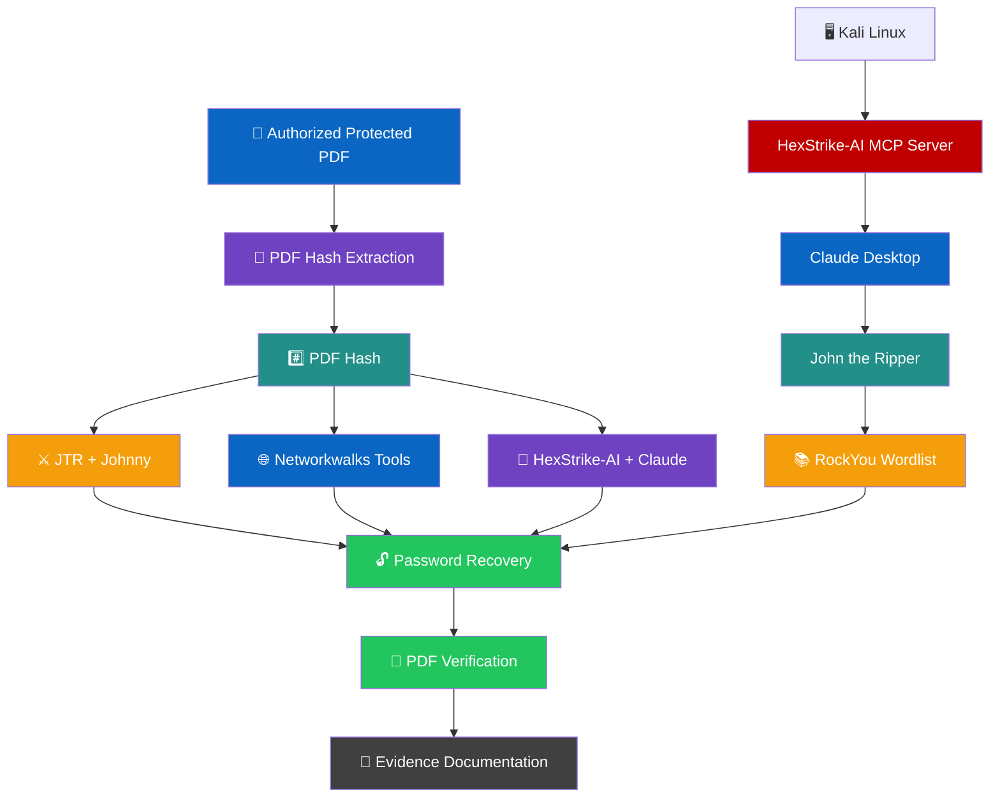
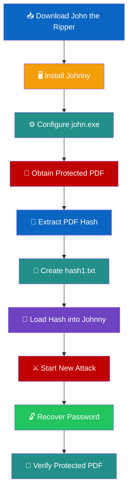
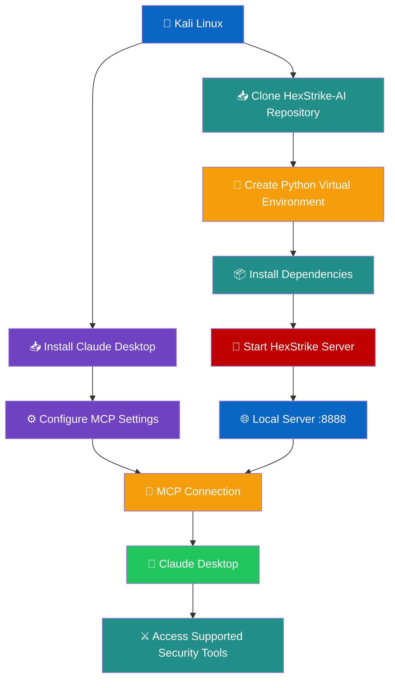
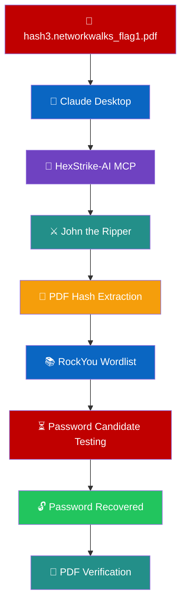

<div align="center">

# 🛡️ PASSWORD SECURITY & AI-ASSISTED PASSWORD CRACKING

### PASSWORD SECURITY • HASH ANALYSIS • JOHN THE RIPPER • HEXSTRIKE-AI • MCP


<br>

**W3-PS-AI | CYBERSECURITY | NETWORKWALKS**

### 👤 Nida Ibrahim Khedekar

**Cybersecurity Intern | Networkwalks Academy | Batch B084**

**Assessment Completed: November 2026**

---

</div>

# 🛡️ 1. Engagement Overview

| **Category**             | **Details**                                            |
| ------------------------ | ------------------------------------------------------ |
| 👤 **Student / Analyst** | Nida Ibrahim Khedekar                                  |
| 🎓 **Program / Batch**   | Networkwalks Cybersecurity Internship – B084           |
| 📅 **Assessment**        | November 2026                                          |
| 🧪 **Week**              | Week 03                                                |
| 🔐 **Primary Focus**     | Password Security & AI-Assisted Password Cracking      |
| ⚔️ **Module 01**         | Password Cracking with John the Ripper & Johnny        |
| 🌐 **Module 02**         | Password Cracking with Networkwalks Tools              |
| 🤖 **Module 03**         | HexStrike-AI MCP Server Setup with Claude Desktop      |
| 🧠 **Module 04**         | AI-Assisted Password Cracking using JTR + HexStrike-AI |
| 🖥️ **Platforms**        | Windows & Kali Linux                                   |
| 🔎 **Hash Format**       | PDF Hash (`$pdf$...`)                                  |
| 📚 **Wordlist**          | RockYou (`rockyou.txt`)                                |
| 🔗 **AI Integration**    | Model Context Protocol (MCP)                           |
| 📸 **Evidence**          | Practical Screenshots                                  |
| 🔐 **Authorization**     | Controlled Educational Laboratory                      |
| 📊 **Assessment Status** | Completed                                              |

---

# 🛡️ 2. Liability & Authorization Disclaimer

> **AUTHORIZED SECURITY TESTING ONLY**

All activities documented in this project were performed as part of an authorized cybersecurity educational laboratory provided by Networkwalks Academy.

The practical exercises involved password-security testing against the PDF files supplied for the training exercises.

The techniques demonstrated are intended strictly for:

* Cybersecurity education.
* Ethical hacking training.
* Password-security research.
* Authorized password-recovery exercises.
* AI-assisted security automation.
* Professional skill development.

Password-recovery techniques and security tools must only be used against files, systems, or environments for which appropriate authorization has been obtained.

Unauthorized password cracking, credential recovery, or access attempts may violate applicable laws and regulations.

**All tools and techniques documented in this repository must be used responsibly and within an explicitly authorized scope.**

> 🛡️ Security principle: Understand the target, define the scope, obtain authorization, execute responsibly, and document the results.

---

# 🛡️ 3. Introduction

This project documents the practical activities completed during **Week 3 of my Cybersecurity & Ethical Hacking internship with Networkwalks Academy**.

The week's activities focused on password security, PDF hash extraction, password recovery, John the Ripper, AI-assisted security testing, and MCP-based integration.

Unlike a conventional password-cracking exercise, this week's practical also introduced an AI-assisted approach using **HexStrike-AI MCP Server integrated with Claude Desktop**.

The assessment consisted of four practical modules.

### Practical Modules

```text
MODULE 01
John the Ripper + Johnny
        ↓
PDF Hash Extraction
        ↓
Password Recovery
        ↓
PDF Verification

MODULE 02
Networkwalks Hash Calculator
        ↓
Networkwalks Password Cracker
        ↓
Password Recovery
        ↓
PDF Verification

MODULE 03
HexStrike-AI MCP Server
        ↓
Claude Desktop Installation
        ↓
Python Virtual Environment
        ↓
Dependencies Installation
        ↓
MCP Configuration
        ↓
Server Integration

MODULE 04
AI-Assisted Password Cracking
        ↓
Claude Desktop
        ↓
HexStrike-AI MCP
        ↓
John the Ripper
        ↓
RockYou Wordlist
        ↓
Password Recovery
        ↓
PDF Verification
```

The exercises provided practical exposure to both traditional password-security tools and AI-assisted security automation.

---

# 🛡️ 4. Objectives

The primary objectives of the Week 3 practical were to:

* Understand password-security fundamentals.
* Understand PDF password protection and hash extraction.
* Install and configure John the Ripper.
* Configure and operate Johnny GUI.
* Extract PDF password hashes.
* Prepare hash files for password-recovery testing.
* Use Networkwalks Hash Calculator.
* Use Networkwalks Password Cracker.
* Understand the role of wordlists in password recovery.
* Explore the RockYou wordlist.
* Install and configure Claude Desktop on Kali Linux.
* Set up HexStrike-AI MCP Server.
* Create and configure a Python virtual environment.
* Install the required Python dependencies.
* Integrate HexStrike-AI with Claude Desktop through MCP.
* Verify John the Ripper availability through the AI-integrated environment.
* Perform AI-assisted password recovery.
* Understand AI-assisted security-tool orchestration.
* Capture practical evidence and document the results.

---

# 🛡️ 5. Tools & Technologies

| **Tool / Technology**         | **Purpose**                                                               |
| ----------------------------- | ------------------------------------------------------------------------- |
| Windows                       | Primary environment for Modules 01 and 02                                 |
| Kali Linux                    | Environment for Modules 03 and 04                                         |
| John the Ripper               | Password-security testing                                                 |
| Johnny GUI                    | Graphical interface for John the Ripper                                   |
| Claude Desktop                | AI desktop application                                                    |
| HexStrike-AI                  | AI-assisted cybersecurity tool orchestration                              |
| MCP                           | Communication protocol for connecting AI applications with external tools |
| Python 3                      | Runtime environment for HexStrike-AI                                      |
| Python Virtual Environment    | Isolated dependency management                                            |
| pip                           | Python package installation                                               |
| Git                           | Repository cloning                                                        |
| GitHub                        | Source code and project documentation                                     |
| RockYou Wordlist              | Password candidate dictionary                                             |
| Networkwalks Hash Calculator  | PDF hash extraction                                                       |
| Networkwalks Password Cracker | Browser-based password recovery                                           |
| Protected PDF                 | Authorized laboratory target                                              |
| Screenshots                   | Evidence collection                                                       |

---

# 🛡️ 6. Lab Architecture

The Week 3 assessment combined traditional password-recovery tools, browser-based utilities, and AI-assisted security automation.



---

# 🛡️ 7. Module 01 – Password Cracking with John the Ripper & Johnny

## 7.1 Module Overview

The first module focused on using **John the Ripper (JTR)** and its graphical interface, Johnny, to recover the password of an authorized protected PDF.

John the Ripper is a password-security auditing tool capable of testing password candidates against supported password hashes.

Johnny provides a graphical interface that simplifies interaction with John the Ripper.

The practical involved obtaining the software, configuring Johnny, extracting the PDF hash, loading the hash file, initiating password recovery, and verifying the recovered password.

## 7.2 Module Environment

| **Component**   | **Details**              |
| --------------- | ------------------------ |
| Platform        | Windows PC               |
| Password Tool   | John the Ripper          |
| GUI             | Johnny                   |
| Target          | Authorized Protected PDF |
| Hash Extraction | PDF Hash Extractor       |
| Hash Format     | `$pdf$...`               |
| Hash File       | `hash1.txt`              |
| Verification    | Protected PDF            |

## 7.3 Module 01 Workflow



## 7.4 Practical Procedure

### 🔹 7.4.1 Download John the Ripper

John the Ripper was downloaded from its official distribution source.

Official website:

https://www.openwall.com/john/

### 🔹 7.4.2 Install Johnny GUI

Johnny was downloaded and installed on the Windows PC.

The graphical interface provided a convenient way to configure and operate John the Ripper.

### 🔹 7.4.3 Configure John the Ripper

The Johnny settings were opened.

The `john.exe` executable was located inside the JTR `run` directory and selected as the John the Ripper executable.

This established the connection between Johnny and the underlying JTR installation.

### 🔹 7.4.4 Obtain the Protected PDF

The PDF supplied with the Networkwalks practical exercise was downloaded and used as the authorized laboratory target.

### 🔹 7.4.5 Extract the PDF Hash

The PDF hash extractor was used to obtain the password-related hash from the protected PDF.

The extracted value followed the PDF hash format:

```text
$pdf$...
```

The hash was checked to ensure that unnecessary characters were not included.

### 🔹 7.4.6 Create the Hash File

The extracted hash was copied into Notepad and saved as:

```text
hash1.txt
```

The file was prepared in the required format for John the Ripper.

### 🔹 7.4.7 Load the Hash into Johnny

Johnny was opened and the **Open Password File** option was selected.

The previously created `hash1.txt` file was loaded.

### 🔹 7.4.8 Start the Password-Recovery Process

The **Start New Attack** option was selected.

John the Ripper began testing password candidates against the extracted PDF hash.

The recovery process demonstrated how password-auditing tools can identify weak or predictable passwords.

### 🔹 7.4.9 Verify the Recovered Password

The recovered password was entered into the protected PDF.

The PDF opened successfully, confirming the password-recovery result.

---
‎‎---
‎
‎# 🛡️ 7. Module 01 Evidence
‎
‎> Evidence screenshots are organized under:
‎>
‎> `module-1-jtr/evidence/`
‎
‎###  JTR / Johnny Setup
‎
‎
‎
‎
‎---
‎
‎###  PDF Hash Extraction
‎
‎
‎
‎
‎
‎
‎
‎
‎
‎---
‎
‎### 📝 Hash File
‎
‎
‎
‎
‎
‎
‎
‎
‎---
‎
‎### ⚔️ Password Recovery
‎
‎
‎
‎
‎
‎
‎
‎---
‎
‎# 🛡️ 8. Module 02 Password Cracking with Networkwalks Tools
‎
‎## 8.1  Module Overview


# 🛡️ 8. Module 02 – Password Cracking with Networkwalks Tools

## 8.1 Module Overview

The second module introduced browser-based password-security tools developed by Networkwalks.

Unlike the first module, which used a locally installed password-recovery application, this exercise used two web-based tools:

* Networkwalks Hash Calculator.
* Networkwalks Password Cracker.

The practical demonstrated a browser-based workflow for extracting a PDF hash and performing password recovery.

## 8.2 Module Environment

| **Component** | **Details**                   |
| ------------- | ----------------------------- |
| Platform      | Windows Laptop                |
| Interface     | Web Browser                   |
| Hash Tool     | Networkwalks Hash Calculator  |
| Recovery Tool | Networkwalks Password Cracker |
| Target        | Authorized Protected PDF      |
| Hash Format   | `$pdf$...`                    |
| Verification  | Protected PDF                 |

## 8.3 Module 02 Workflow


## 8.4 Practical Procedure

### 🔹 8.4.1 Obtain the Protected PDF

The encrypted PDF supplied with the Networkwalks practical was downloaded.

### 🔹 8.4.2 Open Networkwalks Hash Calculator

The Hash Calculator was accessed through the web browser.

Tool:

https://networkwalks.com/hash-calculator/

### 🔹 8.4.3 Upload the PDF

The protected PDF was uploaded to the Hash Calculator.

The tool processed the document and generated the corresponding PDF hash.

### 🔹 8.4.4 Copy the Complete Hash

The complete hash value beginning with `$pdf$` was copied.

Ensuring that the entire hash was preserved was important for the next stage.

### 🔹 8.4.5 Open Networkwalks Password Cracker

The Password Cracker was opened in the browser.

Tool:

https://networkwalks.com/password-cracker/

### 🔹 8.4.6 Submit the Hash

The extracted PDF hash was pasted into the Password Cracker.

The password-recovery process was initiated.

### 🔹 8.4.7 Verify the Result

After the recovery process completed, the recovered password was entered into the protected PDF.

The document opened successfully, confirming the result.

---

# 🛡️ 9. Module 03 – HexStrike-AI MCP Server Setup with Claude Desktop

## 9.1 Module Overview

The third module introduced an AI-assisted cybersecurity environment using **HexStrike-AI MCP Server and Claude Desktop on Kali Linux**.

The objective was to establish communication between Claude Desktop and the HexStrike-AI MCP Server.

This module introduced the practical use of the **Model Context Protocol (MCP)** to connect an AI application with external tools.

HexStrike-AI provides an integration layer that allows supported cybersecurity tools to be accessed through an AI-assisted workflow.

Unlike the previous modules, this exercise focused on environment preparation, dependency management, server execution, and MCP configuration.

## 9.2 Module Environment

| **Component**       | **Details**                |
| ------------------- | -------------------------- |
| Operating System    | Kali Linux                 |
| AI Application      | Claude Desktop             |
| MCP Server          | HexStrike-AI               |
| Repository          | `0x4m4/hexstrike-ai`       |
| Installation Method | GitHub                     |
| Runtime             | Python 3                   |
| Dependency Manager  | pip                        |
| Environment         | Python Virtual Environment |
| Server Script       | `hexstrike_server.py`      |
| MCP Script          | `hexstrike_mcp.py`         |
| Server Port         | `8888`                     |
| Integration         | MCP                        |
| Status              | Successfully Configured    |

## 9.3 Module 03 Architecture



## 9.4 Practical Procedure

### 🔹 9.4.1 Download Claude Desktop

Claude Desktop was installed on Kali Linux using the Debian package repository provided by the Claude Desktop Debian project.

The installation involved adding the repository's GPG key, configuring the package repository, updating package information, and installing Claude Desktop.

Repository:

https://github.com/aaddrick/claude-desktop-debian

Installation commands:

```bash
# Add the GPG key
curl -fsSL https://pkg.claude-desktop-debian.dev/KEY.gpg | sudo gpg --dearmor -o /usr/share/keyrings/claude-desktop.gpg

# Add the repository
echo "deb [signed-by=/usr/share/keyrings/claude-desktop.gpg arch=amd64,arm64] https://pkg.claude-desktop-debian.dev stable main" | sudo tee /etc/apt/sources.list.d/claude-desktop.list

# Update package information
sudo apt update

# Install Claude Desktop
sudo apt install claude-desktop
```

### 🔹 9.4.2 Launch Claude Desktop

After installation, Claude Desktop was opened.

The sign-in process was completed to access the application.

### 🔹 9.4.3 Download HexStrike-AI

The HexStrike-AI repository was obtained from GitHub.

Repository:

https://github.com/0x4m4/hexstrike-ai

The repository was cloned using Git.

```bash
git clone https://github.com/0x4m4/hexstrike-ai.git

cd hexstrike-ai
```

### 🔹 9.4.4 Create a Python Virtual Environment

A dedicated Python virtual environment was created to isolate the dependencies required by HexStrike-AI.

```bash
python3 -m venv hexstrike-env
```

The virtual environment was activated:

```bash
source hexstrike-env/bin/activate
```

Using a virtual environment helps prevent conflicts with Kali Linux's system-managed Python packages.

### 🔹 9.4.5 Install Python Dependencies

After activating the virtual environment, the required dependencies were installed from the repository's requirements file.

```bash
python -m pip install -r requirements.txt
```

This installed the Python packages required by the HexStrike-AI project.

### 🔹 9.4.6 Start HexStrike-AI MCP Server

After dependency installation, the repository directory was accessed again.

The virtual environment was activated and the HexStrike server was started.

```bash
cd ~/hexstrike-ai

source hexstrike-env/bin/activate

python3 hexstrike_server.py
```

The server was configured to run locally on:

```text
http://localhost:8888
```

### 🔹 9.4.7 Configure MCP in Claude Desktop

The MCP configuration was added to Claude Desktop.

Configuration:

```json
{
  "mcpServers": {
    "hexstrike-ai": {
      "command": "/home/kali/hexstrike-ai/hexstrike-env/bin/python",
      "args": [
        "/home/kali/hexstrike-ai/hexstrike_mcp.py",
        "--server",
        "http://localhost:8888"
      ]
    }
  }
}
```

The configuration established the connection between Claude Desktop and the HexStrike-AI MCP integration.

### 🔹 9.4.8 Verify the Integration

After configuring MCP, Claude Desktop was used to access the HexStrike-AI integration.

The setup established the required communication between the AI application and the local HexStrike server.

> **Important:** The MCP integration and the HexStrike server are separate components. Both must be configured and running correctly for the complete workflow to operate.

---

# 🛡️ 10. Module 04 – AI-Assisted Password Cracking with JTR + HexStrike-AI

## 10.1 Module Overview

The fourth module was an extension of the previous HexStrike-AI setup exercise.

The objective was to use **John the Ripper through HexStrike-AI MCP with Claude Desktop** to perform an authorized PDF password-recovery exercise.

This practical introduced an AI-assisted approach to security-tool interaction.

Instead of manually executing every JTR command in the terminal, natural-language prompts were provided through Claude Desktop.

Claude Desktop communicated with the HexStrike-AI MCP integration, which provided access to supported security tools.

The RockYou wordlist was used as the password-candidate dictionary for the exercise.

This module combined:

* AI-assisted tool interaction.
* MCP-based integration.
* John the Ripper.
* PDF hash extraction.
* Dictionary-based password testing.
* Kali Linux.
* RockYou wordlist.

## 10.2 Module Environment

| **Component**            | **Details**                    |
| ------------------------ | ------------------------------ |
| Operating System         | Kali Linux                     |
| AI Application           | Claude Desktop                 |
| MCP Integration          | HexStrike-AI                   |
| Password Tool            | John the Ripper                |
| Wordlist                 | `rockyou.txt`                  |
| Target File              | `hash3.networkwalks_flag1.pdf` |
| Hash Format              | PDF Hash                       |
| Input Location           | `/home/kali/Desktop/`          |
| Password-Recovery Method | Dictionary-Based Testing       |
| Interaction              | Natural-Language Prompts       |
| Status                   | Completed                      |

## 10.3 Module 04 Architecture



## 10.4 Practical Procedure

### 🔹 10.4.1 Obtain the Target PDF

The PDF supplied with the Networkwalks AI-assisted JTR practical was downloaded.

Target filename:

```text
hash3.networkwalks_flag1.pdf
```

The file was copied to the Kali Linux desktop.

Target location:

```text
/home/kali/Desktop/hash3.networkwalks_flag1.pdf
```

### 🔹 10.4.2 Open Claude Desktop

Claude Desktop was launched on Kali Linux.

The application was used as the AI interface for interacting with the configured HexStrike-AI MCP server.

### 🔹 10.4.3 Verify John the Ripper Availability

The first natural-language prompt was provided to Claude Desktop:

```text
Check if John the Ripper is installed in this
HexStrike MCP and show me its version.
```

The purpose was to verify whether John the Ripper was available through the integrated environment.

### 🔹 10.4.4 Calculate the PDF Hash

The next prompt requested PDF hash extraction:

```text
Please calculate the hash value of this PDF file:

/home/kali/Desktop/hash3.networkwalks_flag1.pdf
```

The PDF was processed to obtain its corresponding password hash.

### 🔹 10.4.5 Initiate AI-Assisted Password Recovery

After obtaining the PDF hash, the following prompt was provided:

```text
Please use JTR tool in this HexStrike MCP server
to crack the password of this PDF file.

Use the rockyou.txt wordlist dictionary.
```

Claude Desktop used the HexStrike-AI MCP integration to interact with the supported John the Ripper workflow.

### 🔹 10.4.6 Use the RockYou Wordlist

The RockYou wordlist was used as the dictionary containing candidate passwords.

RockYou is a commonly used wordlist in cybersecurity education and authorized password-security testing.

Its commonly referenced Kali Linux location is:

```text
/usr/share/wordlists/rockyou.txt
```

Depending on the Kali installation, the compressed wordlist may need to be extracted before use.

### 🔹 10.4.7 Password Recovery

John the Ripper performed dictionary-based password testing using the extracted PDF hash and the selected wordlist.

The password-recovery process continued until a matching password was identified.

The recovered password was displayed through the AI-assisted workflow.

### 🔹 10.4.8 Verify the Recovered Password

The recovered password was used to access the protected PDF.

Successful access confirmed the result of the AI-assisted password-recovery exercise.

## 10.5 AI Prompts Used

| **Stage** | **Prompt Purpose**                                   |
| --------- | ---------------------------------------------------- |
| 01        | Check John the Ripper installation and version       |
| 02        | Calculate the hash of the supplied PDF               |
| 03        | Use JTR through HexStrike-AI to recover the password |
| 04        | Specify RockYou as the wordlist                      |

---

# 🛡️ 11. Practical Evidence

Evidence screenshots for the four modules are organized separately to maintain clear documentation.

Recommended repository structure:

```text
WEEK-03-PASSWORD-SECURITY/
│
├── README.md
│
├── module-1-jtr-johnny/
│   └── evidence/
│
├── module-2-networkwalks-tools/
│   └── evidence/
│
├── module-3-hexstrike-mcp-setup/
│   └── evidence/
│
└── module-4-ai-assisted-jtr/
    └── evidence/
```

## 📸 Module 01 – John the Ripper & Johnny

Evidence categories:

* John the Ripper download.
* Johnny installation.
* Johnny configuration.
* JTR executable selection.
* PDF hash extraction.
* Hash-file creation.
* Hash-file loading.
* Password-recovery process.
* Successful PDF verification.

**Evidence location:**

`module-1-jtr-johnny/evidence/`

---

## 📸 Module 02 – Networkwalks Tools

Evidence categories:

* Networkwalks Hash Calculator.
* Protected PDF upload.
* Extracted PDF hash.
* Password Cracker.
* Password-recovery result.
* PDF verification.

**Evidence location:**

`module-2-networkwalks-tools/evidence/`

---

## 📸 Module 03 – HexStrike-AI MCP Setup

Evidence categories:

* Claude Desktop installation.
* Claude Desktop launch.
* HexStrike-AI GitHub repository.
* Repository cloning.
* Python virtual environment.
* Dependency installation.
* HexStrike server execution.
* MCP configuration.
* Claude Desktop integration.

**Evidence location:**

`module-3-hexstrike-mcp-setup/evidence/`

---

## 📸 Module 04 – AI-Assisted JTR

Evidence categories:

* Target PDF on Kali Linux desktop.
* Claude Desktop interface.
* John the Ripper version verification.
* PDF hash extraction prompt.
* Extracted PDF hash.
* AI-assisted JTR execution.
* RockYou wordlist usage.
* Password-recovery result.
* Successful PDF verification.

**Evidence location:**

`module-4-ai-assisted-jtr/evidence/`

---

# 🛡️ 12. Module Comparison

| **Category**    | **Module 01**      | **Module 02**          | **Module 03**  | **Module 04**        |
| --------------- | ------------------ | ---------------------- | -------------- | -------------------- |
| Primary Focus   | JTR & Johnny       | Browser-Based Recovery | MCP Setup      | AI-Assisted Recovery |
| Platform        | Windows            | Windows                | Kali Linux     | Kali Linux           |
| Main Tool       | John the Ripper    | Networkwalks Tools     | HexStrike-AI   | John the Ripper      |
| Interface       | Johnny GUI         | Web Browser            | Claude Desktop | Claude Desktop       |
| Hash Extraction | PDF Hash Extractor | Hash Calculator        | PDF Processing | HexStrike-AI         |
| Wordlist        | Not specified      | Tool-managed           | Not applicable | RockYou              |
| AI Integration  | No                 | No                     | Yes            | Yes                  |
| MCP             | No                 | No                     | Yes            | Yes                  |
| Result          | Completed          | Completed              | Configured     | Completed            |

## Results Summary

| **Assessment**                  | **Result**   |
| ------------------------------- | ------------ |
| JTR & Johnny Setup              | ✅ Completed  |
| PDF Hash Extraction             | ✅ Successful |
| Johnny Password Recovery        | ✅ Successful |
| Networkwalks Hash Calculator    | ✅ Completed  |
| Networkwalks Password Cracker   | ✅ Successful |
| Claude Desktop Installation     | ✅ Completed  |
| HexStrike-AI Repository Setup   | ✅ Completed  |
| Python Virtual Environment      | ✅ Configured |
| Dependency Installation         | ✅ Completed  |
| HexStrike Server Execution      | ✅ Completed  |
| MCP Configuration               | ✅ Completed  |
| Claude Desktop Integration      | ✅ Configured |
| JTR Version Verification        | ✅ Completed  |
| AI-Assisted PDF Hash Extraction | ✅ Completed  |
| RockYou Wordlist Usage          | ✅ Completed  |
| AI-Assisted Password Recovery   | ✅ Successful |
| PDF Verification                | ✅ Successful |

---

# 🛡️ 13. Password Security Concepts

## 13.1 Password Cracking

Password cracking refers to the process of recovering or identifying a password by testing candidate passwords against a stored password hash or protected-file authentication mechanism.

In cybersecurity, password-cracking tools are used for authorized security assessments to evaluate password strength.

## 13.2 Hashing

Hashing is a process that transforms input data into a derived representation known as a hash or message digest.

Cryptographic hash functions are generally designed to be one-way transformations.

In this practical, the extracted PDF hash served as the input for password-recovery testing.

**Important distinction:** A PDF password hash is an encoded representation of password-verification parameters. John the Ripper tests candidate passwords against those parameters; it does not simply reverse a hash.

## 13.3 Encryption vs Hashing

```text
ENCRYPTION

Plaintext
    ↓
Encryption
    ↓
Ciphertext
    ↓
Decryption with the correct key
    ↓
Plaintext


HASHING

Input
    ↓
Hash Function
    ↓
Hash / Digest
```

Encryption is designed to be reversible when the appropriate key is available.

Cryptographic hashing is generally designed as a one-way transformation.

The practical demonstrated how password-protected PDF files can be analyzed through authorized password-recovery techniques.

## 13.4 Dictionary Attack

A dictionary attack uses a collection of candidate passwords to test against a password hash.

The RockYou wordlist was used in the AI-assisted JTR practical.

The effectiveness of dictionary-based testing depends on whether the password appears in the selected wordlist and the characteristics of the target's password protection.

## 13.5 Wordlists

A wordlist is a collection of candidate passwords used during password-security testing.

Common wordlist locations in Kali Linux include:

```text
/usr/share/wordlists/
```

The RockYou wordlist is commonly used in educational password-auditing exercises.

## 13.6 Model Context Protocol (MCP)

Model Context Protocol is a standard that enables AI applications to communicate with external tools and data sources through defined interfaces.

In this practical, MCP was used to connect Claude Desktop with HexStrike-AI.

This allowed the AI application to interact with supported cybersecurity tools through the configured integration.

## 13.7 AI-Assisted Security Automation

AI-assisted security automation involves using an AI application to interpret instructions and interact with supported tools through integrations.

In this exercise:

```text
Natural Language Prompt
        ↓
Claude Desktop
        ↓
MCP Integration
        ↓
HexStrike-AI
        ↓
John the Ripper
        ↓
Password-Recovery Workflow
        ↓
Result
```

This demonstrated how AI can simplify interaction with security tools while still relying on the underlying technical capabilities of those tools.

---

# 🛡️ 14. Skills Demonstrated

<p align="center">


</p>

### Technical Skills

* Password-security testing.
* PDF hash extraction.
* John the Ripper.
* Johnny GUI.
* Dictionary-based password testing.
* RockYou wordlist.
* Networkwalks cybersecurity tools.
* Kali Linux.
* Claude Desktop installation.
* HexStrike-AI configuration.
* MCP integration.
* Python virtual environments.
* Python dependency management.
* Git and GitHub.
* AI-assisted security-tool interaction.
* Technical troubleshooting.
* Evidence collection.
* Professional technical documentation.

---

# 🛡️ 15. Observations & Technical Considerations

## Observation 01 – PDF Hash Format

The extracted PDF hash must be preserved correctly before being supplied to a password-recovery tool.

The `$pdf$` prefix identifies the PDF hash format used in this exercise.

Incomplete or incorrectly formatted hashes can cause password-recovery workflows to fail.

---

## Observation 02 – Password Complexity

Password-recovery duration depends on:

* Password length.
* Password complexity.
* Candidate search space.
* Wordlist contents.
* Hardware capabilities.
* Attack configuration.

Predictable passwords may be easier to recover using dictionary-based techniques.

---

## Observation 03 – Virtual Environment Management

Kali Linux uses an externally managed Python environment.

A dedicated virtual environment is useful for installing project-specific Python dependencies without modifying system-managed packages.

The HexStrike-AI practical introduced this approach through:

```bash
python3 -m venv hexstrike-env

source hexstrike-env/bin/activate
```

---

## Observation 04 – MCP Configuration

The MCP configuration requires the correct executable path, server script path, and local server address.

Incorrect paths or unavailable server processes can prevent successful communication between Claude Desktop and HexStrike-AI.

---

## Observation 05 – AI-Assisted Tool Interaction

The HexStrike-AI exercise demonstrated that natural-language prompts can be used to interact with supported cybersecurity tools through an MCP integration.

However, AI-assisted execution still depends on correct tool configuration, permissions, dependencies, and execution environments.

---

## Observation 06 – Wordlist Selection

The RockYou wordlist was used for dictionary-based password testing.

The practical demonstrated that wordlist selection is an important part of password-security testing.

A password that is absent from a particular wordlist may not be recovered through that dictionary-based attempt.

---

## Observation 07 – Evidence Collection

Cybersecurity documentation should demonstrate:

```text
What was performed
        ↓
How it was performed
        ↓
Which tools were used
        ↓
What was observed
        ↓
What the result demonstrated
        ↓
What security lessons were learned
```

This improves reproducibility, reviewability, and professional presentation.

---

# 🛡️ 16. Risk Analysis & Impact

| **#** | **Observation**                                     | **Security Relevance**                                  | **Potential Impact**                                    | **Risk**  |
| ----: | --------------------------------------------------- | ------------------------------------------------------- | ------------------------------------------------------- | --------- |
|     1 | Weak password identified during authorized recovery | Demonstrates password predictability                    | Increased risk of unauthorized access                   | 🟠 Medium |
|     2 | Password hash available for testing                 | Hashes can be targeted for offline analysis             | Weak passwords may be recovered                         | 🟠 Medium |
|     3 | Dictionary-based testing                            | Common passwords can be identified efficiently          | Predictable credentials may be exposed                  | 🟠 Medium |
|     4 | AI-integrated security tools                        | AI can simplify security-tool interaction               | Misconfigured or unauthorized tool execution            | 🟠 Medium |
|     5 | MCP configuration                                   | External tools are exposed through defined integrations | Incorrect configuration may introduce security concerns | 🟠 Medium |
|     6 | Python dependency management                        | Project dependencies require isolation and maintenance  | Dependency conflicts or vulnerabilities                 | 🟠 Medium |
|     7 | Incomplete hash input                               | Accurate hash handling is essential                     | Recovery workflow may fail                              | 🟢 Low    |
|     8 | Wordlist limitations                                | Dictionary attacks depend on available candidates       | Password may remain unrecovered                         | 🟢 Low    |

> **Assessment Note:** These observations relate to the educational laboratory environment and do not represent vulnerabilities in unrelated production systems.

---

# 🛡️ 17. Security Recommendations

### 1. Use Strong Passwords

Use long, unique, and unpredictable passwords.

### 2. Avoid Password Reuse

Do not reuse the same password across multiple accounts or services.

### 3. Use Password Managers

Password managers help generate and securely store unique passwords.

### 4. Enable Multi-Factor Authentication

MFA provides an additional authentication layer beyond passwords.

### 5. Protect Password Hashes

Organizations should restrict access to password-related data and implement appropriate storage protections.

### 6. Use Modern Password-Storage Mechanisms

Use established password-hashing algorithms such as Argon2id, scrypt, or appropriately configured bcrypt.

### 7. Secure AI Integrations

MCP integrations should follow least-privilege principles and expose only the tools required for the intended workflow.

### 8. Maintain Python Environments

Use isolated virtual environments and keep dependencies updated.

### 9. Validate AI-Generated Actions

AI-assisted security operations should be reviewed and executed only within an authorized scope.

### 10. Document Security Assessments

Maintain clear evidence of procedures, observations, and outcomes.

---

# 🛡️ 18. Security Assessment Summary

| **Assessment Area**                  | **Status**  |
| ------------------------------------ | ----------- |
| Password Security Fundamentals       | ✅ Completed |
| PDF Hash Extraction                  | ✅ Completed |
| John the Ripper                      | ✅ Completed |
| Johnny Configuration                 | ✅ Completed |
| Networkwalks Hash Calculator         | ✅ Completed |
| Networkwalks Password Cracker        | ✅ Completed |
| Claude Desktop Installation          | ✅ Completed |
| HexStrike-AI Installation            | ✅ Completed |
| Python Virtual Environment           | ✅ Completed |
| Python Dependencies                  | ✅ Completed |
| MCP Server Configuration             | ✅ Completed |
| Claude Desktop Integration           | ✅ Completed |
| John the Ripper Version Verification | ✅ Completed |
| AI-Assisted Hash Extraction          | ✅ Completed |
| RockYou Wordlist Usage               | ✅ Completed |
| AI-Assisted Password Recovery        | ✅ Completed |
| PDF Verification                     | ✅ Completed |
| Evidence Collection                  | ✅ Completed |
| Technical Documentation              | ✅ Completed |

### Overall Practical Progress

```text
PASSWORD SECURITY          ████████████████████ 100% COMPLETED ✅

JTR / JOHNNY                ████████████████████ 100% COMPLETED ✅

NETWORKWALKS TOOLS           ████████████████████ 100% COMPLETED ✅

HEXSTRIKE-AI SETUP           ████████████████████ 100% COMPLETED ✅

CLAUDE DESKTOP + MCP         ████████████████████ 100% COMPLETED ✅

AI-ASSISTED PASSWORD CRACKING ████████████████████ 100% COMPLETED ✅

EVIDENCE & DOCUMENTATION     ████████████████████ 100% COMPLETED ✅
```

---

# 🛡️ 19. Key Learning Outcomes

Through the Week 3 practical exercises, I gained hands-on exposure to:

* Password-security fundamentals.
* PDF password protection.
* Hash extraction and analysis.
* John the Ripper.
* Johnny GUI.
* Networkwalks password-security tools.
* Dictionary-based password recovery.
* RockYou wordlist.
* Kali Linux security environment.
* Claude Desktop installation and configuration.
* HexStrike-AI MCP Server.
* Python virtual environment management.
* Python dependency installation.
* MCP-based AI integration.
* AI-assisted cybersecurity workflows.
* Security-tool orchestration.
* Technical troubleshooting.
* Evidence collection.
* Professional cybersecurity documentation.

### Learning Validation

The practical demonstrated the progression from conventional security-tool usage to AI-assisted cybersecurity workflows.

```text
SECURITY FUNDAMENTALS
        ↓
TRADITIONAL SECURITY TOOLS
        ↓
PRACTICAL EXECUTION
        ↓
AI INTEGRATION
        ↓
MCP CONFIGURATION
        ↓
AI-ASSISTED AUTOMATION
        ↓
RESULT VERIFICATION
        ↓
PROFESSIONAL DOCUMENTATION
```

One of the most valuable takeaways was understanding how AI applications can interact with external cybersecurity tools through MCP integrations.

This provided practical exposure to an emerging area of cybersecurity involving AI-assisted tool orchestration.

---

# 🛡️ 20. Conclusion

During **Week 3 of my Cybersecurity & Ethical Hacking internship at Networkwalks Academy**, I completed practical exercises covering password security, hash analysis, password recovery, AI integration, and security-tool automation.

The first module provided hands-on experience with **John the Ripper and Johnny**, including PDF hash extraction, hash-file preparation, password recovery, and verification.

The second module introduced the **Networkwalks Hash Calculator and Password Cracker**, demonstrating a browser-based approach to password recovery.

The third module extended the practical into AI-assisted cybersecurity by setting up **HexStrike-AI MCP Server with Claude Desktop on Kali Linux**.

This involved repository cloning, Python virtual environment creation, dependency installation, server execution, and MCP configuration.

The fourth module brought these components together by using **Claude Desktop, HexStrike-AI MCP, John the Ripper, and the RockYou wordlist** to perform an AI-assisted password-recovery exercise.

The overall practical progression was:

```text
PASSWORD SECURITY
        ↓
HASH ANALYSIS
        ↓
JOHN THE RIPPER
        ↓
NETWORKWALKS SECURITY TOOLS
        ↓
HEXSTRIKE-AI MCP SETUP
        ↓
CLAUDE DESKTOP INTEGRATION
        ↓
AI-ASSISTED PASSWORD RECOVERY
        ↓
VERIFICATION
        ↓
EVIDENCE & DOCUMENTATION
```

This week's exercises helped me understand not only how traditional password-security tools operate but also how AI applications can interact with external cybersecurity tools through MCP.

Most importantly, the practical reinforced the importance of understanding the underlying technology rather than relying entirely on automated tools.

**AI can assist with cybersecurity operations, but technical understanding, proper configuration, validation, and authorization remain essential.**

This project represents another step in my cybersecurity learning journey and contributes to my practical experience in password security, Kali Linux, security tooling, AI-assisted automation, and technical documentation.

---

# 🛡️ 21. Project Information

| **Project Detail**       | **Information**                                   |
| ------------------------ | ------------------------------------------------- |
| 👤 **Author**            | Nida Ibrahim Khedekar                             |
| 🏢 **Organization**      | Networkwalks Academy                              |
| 🎓 **Program**           | Cybersecurity & Ethical Hacking Internship        |
| 📅 **Week**              | Week 03                                           |
| 🎓 **Batch**             | B084                                              |
| 📆 **Assessment**        | November 2026                                     |
| 🔐 **Project Type**      | Authorized Cybersecurity Laboratory               |
| 🛡️ **Primary Focus**    | Password Security & AI-Assisted Password Cracking |
| ⚔️ **Module 01**         | John the Ripper & Johnny                          |
| 🌐 **Module 02**         | Networkwalks Hash Calculator & Password Cracker   |
| 🤖 **Module 03**         | HexStrike-AI MCP Server Setup                     |
| 🧠 **Module 04**         | AI-Assisted Password Cracking                     |
| 💻 **Platforms**         | Windows & Kali Linux                              |
| 🔗 **AI Application**    | Claude Desktop                                    |
| 🧰 **MCP Integration**   | HexStrike-AI                                      |
| 📚 **Wordlist**          | RockYou                                           |
| 📸 **Evidence**          | Practical Screenshots                             |
| 📊 **Assessment Status** | Completed                                         |

---

# 👤 22. Author

<div align="center">

### **Nida Ibrahim Khedekar**

**Cybersecurity Intern | Networkwalks Academy | Batch B084**

<br>

🛡️ **Cybersecurity & Ethical Hacking**

<br>

**Week 03 – Password Security & AI-Assisted Password Cracking**

<br>

**Learn • Practice • Analyze • Automate • Secure**

</div>

---

# 🛡️ 23. Assessment Progress

```text
PHASE 1
Password Security & JTR / Johnny
████████████████████████████████ COMPLETED ✅

PHASE 2
Networkwalks Password-Security Tools
████████████████████████████████ COMPLETED ✅

PHASE 3
HexStrike-AI MCP Server Setup
████████████████████████████████ COMPLETED ✅

PHASE 4
Claude Desktop Integration
████████████████████████████████ COMPLETED ✅

PHASE 5
AI-Assisted JTR Password Recovery
████████████████████████████████ COMPLETED ✅

PHASE 6
RockYou Wordlist & Verification
████████████████████████████████ COMPLETED ✅

PHASE 7
Evidence Collection & Documentation
████████████████████████████████ COMPLETED ✅
```

---

<div align="center">

### 🛡️ CYBERSECURITY • ETHICAL HACKING • AI-ASSISTED SECURITY

**Learn → Practice → Analyze → Automate → Document → Secure**

<br>

*W3-PS-AI | Networkwalks Academy | Batch B084 | November 2026*

<br>

**Nida Ibrahim Khedekar**

</div>

---
